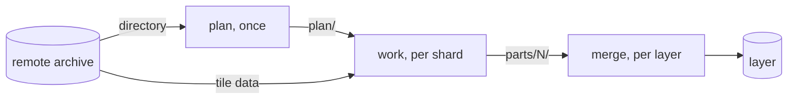

# How the pipeline works

Why the pipeline exists, what happens in a run, and where its boundaries
are. tilealchemist's own terms, such as entry and blob, are explained in its
[How convert works](https://github.com/tilelab/tilealchemist/blob/main/docs/explanation/architecture.md).
Details of a single mechanism are in code comments next to it.

## Why a pipeline

`convert` reads a local archive on one machine, so a planet would first have
to be downloaded and then converted for hours. Fetching tiles one at a time
instead would take about 358 million requests for zoom levels 0 to 14. The
pipeline reads the directory once, gives each worker an equal share to fetch
in a few large range requests, and merges the results without decoding them
again.

## The steps of a run

1. `plan` asks the **source** for the archive's URL and walks its directory
   in two requests: header and root, then only the slice of leaf
   directories the zoom range needs (`plan/planning.py`,
   `fetch/pmtiles_index.py`). It adds the gaps, sorts the entries by offset
   and cuts them into **shards** of equal blob bytes, by the rule `convert`
   uses for its chunks (`plan/gaps.py`, `plan/manifest.py`).
2. A **worker** fetches a shard in as few range requests as possible,
   reading through small holes, into a **shard archive**. It runs `convert`
   on it, which writes one **part** per layer (`work/shard_worker.py`,
   `work/shard_archive.py`).
3. `merge` joins a layer's parts with `pmtiles merge`, which copies tile
   data without decoding (`merge/layer_merge.py`). That works because
   `convert` writes clustered files and every shard archive has the same
   world bounds and center, so all parts have the same header and metadata.

Gaps, the tile IDs the archive lacks, all point at one empty tile in the
shard archives. So profiles see them as empty tiles, and each profile
builds them only once.

## The boundary with tilealchemist

The pipeline has its own command, and tilealchemist never imports it. The
pipeline imports only the run's contract, the checks it repeats to fail
early, and PMTiles helpers the core uses itself. It hands `convert` only
files: a shard archive and `plan/layers.toml`.

## On GitHub Actions

Every job checks out the pipeline at `job.workflow_sha`, the commit the
caller pinned, and runs `.github/actions/setup` from there, because a remote
`uses:` reference can't be an expression. Where that is empty, as on GitHub
Enterprise Server, the run fails rather than build another commit.

## Where the code lives

| Package | Contents |
| --- | --- |
| `cli/` | The `tilealchemist-pipeline` command; each step parses, then calls its module. |
| `plan/` | `plan`: the run config and source, gaps, shards, manifests and `plan.json`. |
| `fetch/` | The remote archive: its directory and metadata, and range requests with retries. |
| `work/` | `work`: the shard archive and the `convert` that reads it. |
| `merge/` | `merge`: `pmtiles merge` and the pinned go-pmtiles binary. |
| `sources/` | `Source` and the shipped sources. |
| `layout.py` | Every path the steps read and write. |
